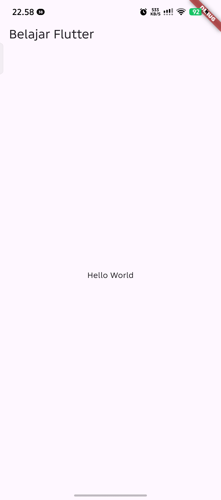
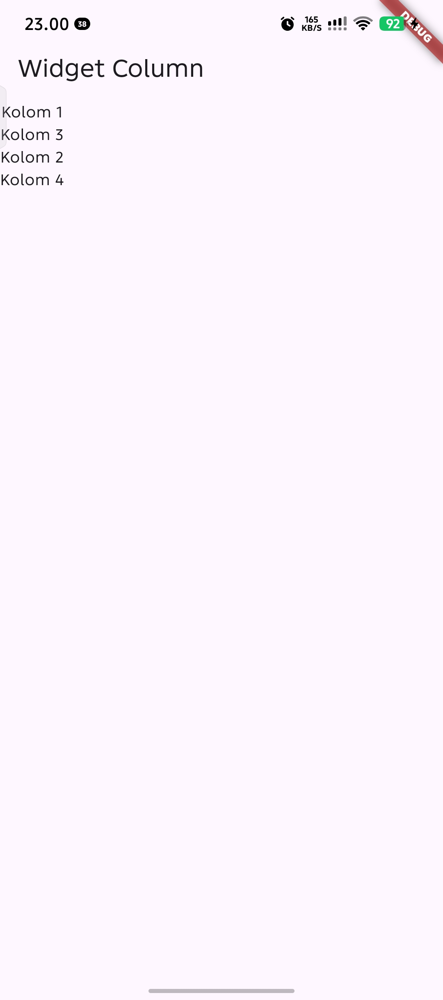
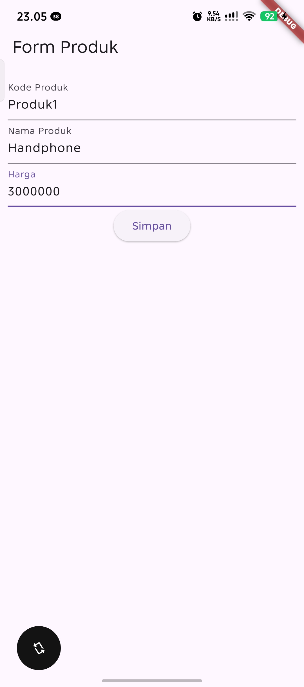
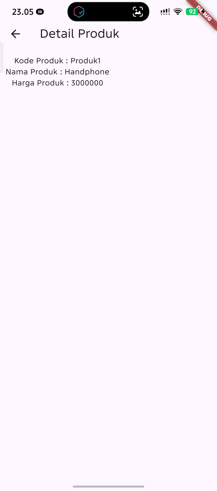

# Praktikum Pemrograman Mobile - Modul 2: Flutter Widget and Design

### Identitas Mahasiswa
| Data | Keterangan |
|---|---|
| **Nama** | Muhammad Abu Umar |
| **NIM** | H1D024084 |
| **Shift KRS** | H |
| **Shift Sekarang** | D |

---

## 1. Struktur Proyek

Berikut adalah berkas kode sumber utama yang dikerjakan pada modul ini:

```text
flutter_modul2/
├── lib/
│   ├── main.dart             # Titik masuk utama aplikasi (MaterialApp)
│   ├── hello_world.dart      # Latihan Bab 7: Widget HelloWorld
│   ├── column_widget.dart    # Latihan Bab 8: Widget Column
│   ├── row_widget.dart       # Latihan Bab 9: Widget Row
│   └── ui/
│       ├── produk_form.dart   # Latihan Bab 10: Formulir input produk
│       ├── produk_detail.dart # Latihan Bab 10: Tampilan detail produk
│       └── produk_page.dart   # Latihan Bab 11: Daftar produk (ListView & Card)
├── Screenshoot_apk/          # Dokumentasi tangkapan layar setiap halaman
└── pubspec.yaml              # Konfigurasi dependensi dan aset proyek
```

---

## 2. Penjelasan Kode Sumber & Tampilan Aplikasi

### A. `lib/main.dart` (Entry Point)
Berkas `main.dart` berfungsi sebagai titik masuk (*entry point*) aplikasi Flutter melalui fungsi `main()`. Fungsi ini menjalankan widget `MyApp` yang membungkus antarmuka dengan `MaterialApp`. Properti `home:` digunakan untuk menentukan halaman mana yang akan dimuat saat aplikasi pertama kali dijalankan.

```dart
void main() {
  runApp(const MyApp());
}

class MyApp extends StatelessWidget {
  const MyApp({Key? key}) : super(key: key);

  @override
  Widget build(BuildContext context) {
    return const MaterialApp(
      title: "Aplikasi Flutter Pertama",
      home: ProdukPage(), // Dapat diarahkan ke widget latihan lainnya
    );
  }
}
```

---

### B. `lib/hello_world.dart` (Bab 7 - Hello World)
- **Fungsi:** Mengenalkan pembuatan berkas widget terpisah menggunakan `StatelessWidget`.
- **Penjelasan Kode:** Menggunakan struktur dasar `Scaffold` yang terdiri dari `AppBar` dengan judul *"Belajar Flutter"*, serta `Center` pada `body` yang menempatkan widget `Text('Hello World')` tepat di tengah layar.
- **Tampilan Antarmuka:**



---

### C. `lib/column_widget.dart` (Bab 8 - Widget Column)
- **Fungsi:** Mengatur tata letak widget secara vertikal (dari atas ke bawah).
- **Penjelasan Kode:** Di dalam `body`, widget `Column` menerima daftar anak (*children*) berupa beberapa widget `Text` (`Kolom 1`, `Kolom 3`, `Kolom 2`, `Kolom 4`). Komponen `Column` menempatkan setiap elemen secara berurutan ke bawah sesuai urutan dalam *list*.
- **Tampilan Antarmuka:**



---

### D. `lib/row_widget.dart` (Bab 9 - Widget Row)
- **Fungsi:** Mengatur tata letak widget secara horizontal (dari kiri ke kanan).
- **Penjelasan Kode:** Menggunakan widget `Row` pada `body` `Scaffold` yang menampung empat widget `Text` (`Row 1`, `Row 2`, `Row 3`, `Row 4`). Komponen `Row` menempatkan seluruh elemen secara menyamping pada satu baris horizontal.
- **Tampilan Antarmuka:**


---

### E. `lib/ui/produk_form.dart` (Bab 10 - Form Input Produk)
- **Fungsi:** Menyediakan antarmuka formulir interaktif bagi pengguna untuk memasukkan data barang serta mengelola *state* input.
- **Penjelasan Kode:** 
  - Menggunakan `StatefulWidget` karena nilai input teks bersifat dinamis.
  - Tiga buah `TextEditingController` (`_kodeProdukController`, `_namaProdukController`, `_hargaProdukController`) digunakan untuk membaca teks dari input `TextField`.
  - Pada tombol `_tombolSimpan`, fungsi `Navigator.push` dipanggil bersama `MaterialPageRoute` untuk berpindah ke halaman `ProdukDetail` sembari mengirimkan nilai kode, nama, dan harga produk yang telah di-parsing ke tipe `int`.
- **Tampilan Antarmuka:**



---

### F. `lib/ui/produk_detail.dart` (Bab 10 - Detail Produk)
- **Fungsi:** Menerima data produk dari formulir dan menampilkannya kepada pengguna.
- **Penjelasan Kode:** Merupakan `StatelessWidget` dengan tiga variabel penampung (`kodeProduk`, `namaProduk`, `hargaProduk`) yang bersifat `required`. Nilai-nilai tersebut ditampilkan di dalam `Column` dengan teks interpolasi seperti `Text("Kode Produk : $kodeProduk")`. Halaman ini secara otomatis menyediakan tombol kembali (←) pada `AppBar` untuk kembali ke form.
- **Tampilan Antarmuka:**



---

### G. `lib/ui/produk_page.dart` (Bab 11 - List Data Produk)
- **Fungsi:** Menampilkan daftar katalog produk dalam bentuk list yang rapi dan terstruktur.
- **Penjelasan Kode:** Menggunakan `ListView` sebagai wadah daftar yang dapat di-scroll. Masing-masing produk dibungkus dengan komponen `Card` untuk memberikan efek bayangan (elevasi) dan diisi menggunakan `ListTile` dengan properti `title` (nama barang seperti Kulkas, Playstation, Radio) dan `subtitle` (harga barang).

---

## 3. Panduan Menjalankan & Mengganti Tampilan Halaman

Setiap latihan pada modul ini dibuat dalam berkas terpisah. Untuk menampilkan halaman tertentu di layar/emulator, ubah baris `import` dan `home:` pada berkas [lib/main.dart](lib/main.dart):

| Target Halaman | Baris Import pada `main.dart` | Baris `home:` pada `MaterialApp` |
|---|---|---|
| **Hello World** | `import 'package:flutter_modul2/hello_world.dart';` | `home: HelloWorld()` |
| **Widget Column** | `import 'package:flutter_modul2/column_widget.dart';` | `home: const ColumnWidget()` |
| **Widget Row** | `import 'package:flutter_modul2/row_widget.dart';` | `home: const RowWidget()` |
| **Form Produk** | `import 'package:flutter_modul2/ui/produk_form.dart';` | `home: const ProdukForm()` |
| **List Produk** | `import 'package:flutter_modul2/ui/produk_page.dart';` | `home: const ProdukPage()` |

Setelah mengubah berkas `lib/main.dart`, simpan berkas (`Ctrl + S`) dan lakukan **Hot Reload** (tekan `r` di terminal atau klik ikon petir pada IDE).
