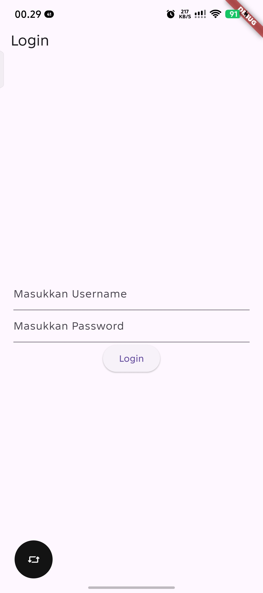
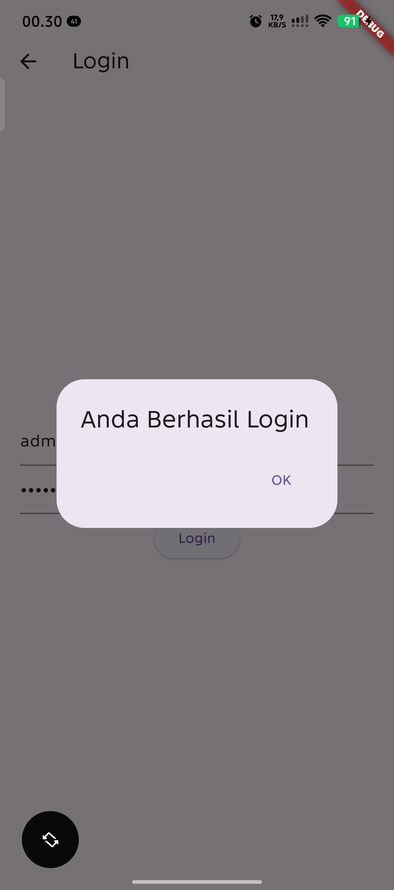
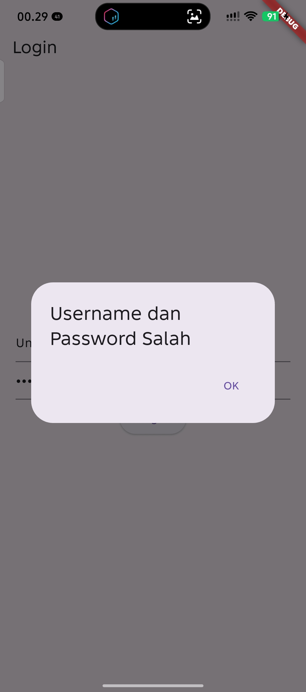
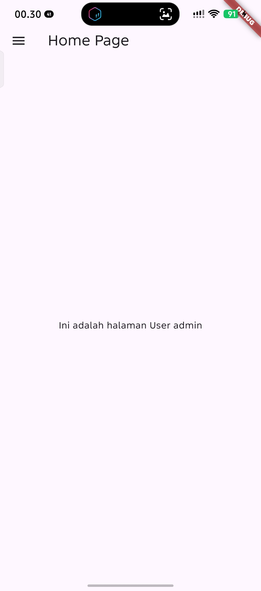
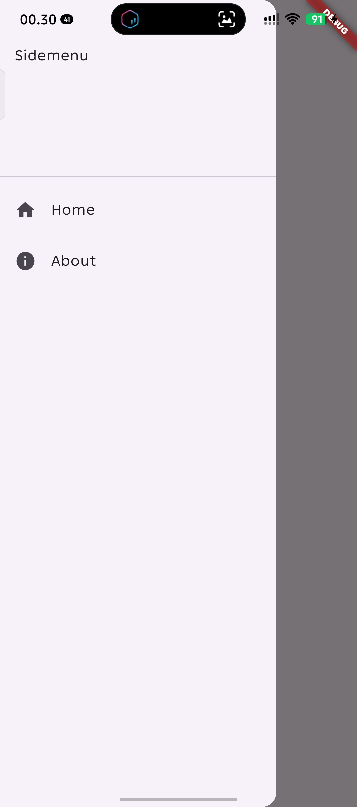
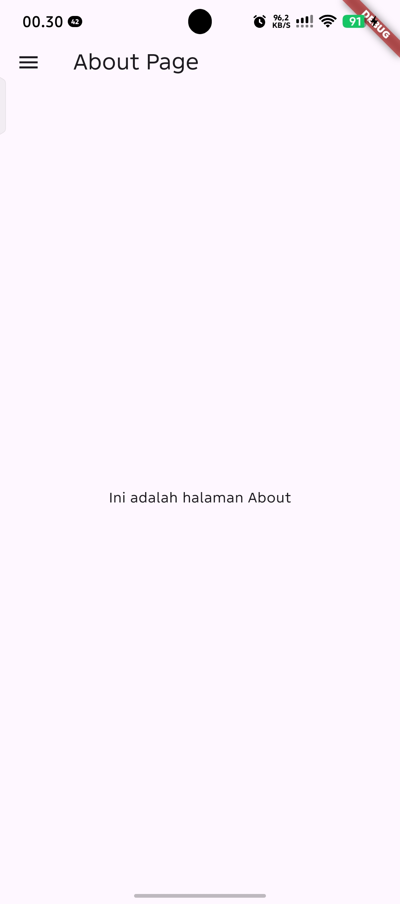

# Praktikum Pemrograman Mobile - Modul 2: Flutter Widget and Design

### Identitas Mahasiswa
| Data | Keterangan |
|---|---|
| **Nama** | Muhammad Abu Umar |
| **NIM** | H1D024084 |
| **Shift KRS** | H |
| **Shift Sekarang** | D |

---

## 1. Struktur Proyek

Berikut adalah berkas kode sumber utama yang dikerjakan pada modul ini:

```text
flutter_modul2/
├── lib/
│   ├── main.dart             # Titik masuk utama aplikasi (MaterialApp)
│   ├── hello_world.dart      # Latihan Bab 7: Widget HelloWorld
│   ├── column_widget.dart    # Latihan Bab 8: Widget Column
│   ├── row_widget.dart       # Latihan Bab 9: Widget Row
│   └── ui/
│       ├── produk_form.dart   # Latihan Bab 10: Formulir input produk
│       ├── produk_detail.dart # Latihan Bab 10: Tampilan detail produk
│       └── produk_page.dart   # Latihan Bab 11: Daftar produk (ListView & Card)
├── Screenshoot_apk/          # Dokumentasi tangkapan layar setiap halaman
└── pubspec.yaml              # Konfigurasi dependensi dan aset proyek
```

---

## 2. Penjelasan Kode Sumber & Tampilan Aplikasi

### A. `lib/main.dart` (Entry Point)
Berkas `main.dart` berfungsi sebagai titik masuk (*entry point*) aplikasi Flutter melalui fungsi `main()`. Fungsi ini menjalankan widget `MyApp` yang membungkus antarmuka dengan `MaterialApp`. Properti `home:` digunakan untuk menentukan halaman mana yang akan dimuat saat aplikasi pertama kali dijalankan.

```dart
void main() {
  runApp(const MyApp());
}

class MyApp extends StatelessWidget {
  const MyApp({Key? key}) : super(key: key);

  @override
  Widget build(BuildContext context) {
    return const MaterialApp(
      title: "Aplikasi Flutter Pertama",
      home: ProdukPage(), // Dapat diarahkan ke widget latihan lainnya
    );
  }
}
```

---

### B. `lib/hello_world.dart` (Bab 7 - Hello World)
- **Fungsi:** Mengenalkan pembuatan berkas widget terpisah menggunakan `StatelessWidget`.
- **Penjelasan Kode:** Menggunakan struktur dasar `Scaffold` yang terdiri dari `AppBar` dengan judul *"Belajar Flutter"*, serta `Center` pada `body` yang menempatkan widget `Text('Hello World')` tepat di tengah layar.
- **Tampilan Antarmuka:**


---

### C. `lib/column_widget.dart` (Bab 8 - Widget Column)
- **Fungsi:** Mengatur tata letak widget secara vertikal (dari atas ke bawah).
- **Penjelasan Kode:** Di dalam `body`, widget `Column` menerima daftar anak (*children*) berupa beberapa widget `Text` (`Kolom 1`, `Kolom 3`, `Kolom 2`, `Kolom 4`). Komponen `Column` menempatkan setiap elemen secara berurutan ke bawah sesuai urutan dalam *list*.
- **Tampilan Antarmuka:**


---

### D. `lib/row_widget.dart` (Bab 9 - Widget Row)
- **Fungsi:** Mengatur tata letak widget secara horizontal (dari kiri ke kanan).
- **Penjelasan Kode:** Menggunakan widget `Row` pada `body` `Scaffold` yang menampung empat widget `Text` (`Row 1`, `Row 2`, `Row 3`, `Row 4`). Komponen `Row` menempatkan seluruh elemen secara menyamping pada satu baris horizontal.
- **Tampilan Antarmuka:**


---

### E. `lib/ui/produk_form.dart` (Bab 10 - Form Input Produk)
- **Fungsi:** Menyediakan antarmuka formulir interaktif bagi pengguna untuk memasukkan data barang serta mengelola *state* input.
- **Penjelasan Kode:** 
  - Menggunakan `StatefulWidget` karena nilai input teks bersifat dinamis.
  - Tiga buah `TextEditingController` (`_kodeProdukController`, `_namaProdukController`, `_hargaProdukController`) digunakan untuk membaca teks dari input `TextField`.
  - Pada tombol `_tombolSimpan`, fungsi `Navigator.push` dipanggil bersama `MaterialPageRoute` untuk berpindah ke halaman `ProdukDetail` sembari mengirimkan nilai kode, nama, dan harga produk yang telah di-parsing ke tipe `int`.
- **Tampilan Antarmuka:**


---

### F. `lib/ui/produk_detail.dart` (Bab 10 - Detail Produk)
- **Fungsi:** Menerima data produk dari formulir dan menampilkannya kepada pengguna.
- **Penjelasan Kode:** Merupakan `StatelessWidget` dengan tiga variabel penampung (`kodeProduk`, `namaProduk`, `hargaProduk`) yang bersifat `required`. Nilai-nilai tersebut ditampilkan di dalam `Column` dengan teks interpolasi seperti `Text("Kode Produk : $kodeProduk")`. Halaman ini secara otomatis menyediakan tombol kembali (←) pada `AppBar` untuk kembali ke form.
- **Tampilan Antarmuka:**


---

### G. `lib/ui/produk_page.dart` (Bab 11 - List Data Produk)
- **Fungsi:** Menampilkan daftar katalog produk dalam bentuk list yang rapi dan terstruktur.
- **Penjelasan Kode:** Menggunakan `ListView` sebagai wadah daftar yang dapat di-scroll. Masing-masing produk dibungkus dengan komponen `Card` untuk memberikan efek bayangan (elevasi) dan diisi menggunakan `ListTile` dengan properti `title` (nama barang seperti Kulkas, Playstation, Radio) dan `subtitle` (harga barang).

---

## 3. Panduan Menjalankan & Mengganti Tampilan Halaman

Setiap latihan pada modul ini dibuat dalam berkas terpisah. Untuk menampilkan halaman tertentu di layar/emulator, ubah baris `import` dan `home:` pada berkas [lib/main.dart](lib/main.dart):

| Target Halaman | Baris Import pada `main.dart` | Baris `home:` pada `MaterialApp` |
|---|---|---|
| **Hello World** | `import 'package:flutter_modul2/hello_world.dart';` | `home: HelloWorld()` |
| **Widget Column** | `import 'package:flutter_modul2/column_widget.dart';` | `home: const ColumnWidget()` |
| **Widget Row** | `import 'package:flutter_modul2/row_widget.dart';` | `home: const RowWidget()` |
| **Form Produk** | `import 'package:flutter_modul2/ui/produk_form.dart';` | `home: const ProdukForm()` |
| **List Produk** | `import 'package:flutter_modul2/ui/produk_page.dart';` | `home: const ProdukPage()` |

Setelah mengubah berkas `lib/main.dart`, simpan berkas (`Ctrl + S`) dan lakukan **Hot Reload** (tekan `r` di terminal atau klik ikon petir pada IDE).


# Praktikum Pemrograman Mobile - Modul 3: Routes, Side Menu, Login, dan Local Storage Framework Flutter


## 1. Struktur Proyek

Berikut adalah struktur berkas kode sumber utama pada proyek ini:

```text
flutter_modul2/
├── lib/
│   ├── main.dart             # Titik masuk utama aplikasi (MaterialApp -> LoginPage)
│   ├── login_page.dart       # Halaman Login, validasi autentikasi, dan simpan SharedPreferences
│   ├── home_page.dart        # Halaman Utama, membaca SharedPreferences dan menampilkan drawer
│   ├── sidemenu.dart         # Komponen Side Menu (Drawer) dengan navigasi Home & About
│   ├── about_page.dart       # Halaman About dengan integrasi drawer Sidemenu
│   ├── hello_world.dart      # (Modul 2) Latihan dasar Hello World
│   ├── column_widget.dart    # (Modul 2) Latihan tata letak Column
│   ├── row_widget.dart       # (Modul 2) Latihan tata letak Row
│   └── ui/                   # (Modul 2) Komponen antarmuka katalog produk
│       ├── produk_form.dart
│       ├── produk_detail.dart
│       └── produk_page.dart
├── SS_Modul3/                # Dokumentasi tangkapan layar Modul 3
├── Screenshoot_apk/          # Dokumentasi tangkapan layar Modul 2
├── test/
│   └── widget_test.dart      # Pengujian unit & widget flow login, navigasi, dan state
└── pubspec.yaml              # Konfigurasi dependensi (shared_preferences, flutter SDK)
```

---

## 2. Dependensi Tambahan

Pada modul ini, ditambahkan dependensi `shared_preferences` pada berkas `pubspec.yaml` untuk mengelola penyimpanan data lokal (*local storage*) berbasis pasangan kunci-nilai (*key-value*):

```yaml
dependencies:
  flutter:
    sdk: flutter
  cupertino_icons: ^1.0.8
  shared_preferences: ^2.0.17
```

---

## 3. Penjelasan Kode Sumber & Dokumentasi Tampilan (Modul 3)

### A. `lib/main.dart` (Titik Masuk Aplikasi)
Berkas ini bertindak sebagai entry point aplikasi Flutter. Fungsi `main()` menjalankan widget `MyApp` yang mengembalikan `MaterialApp`. Properti `home:` diarahkan langsung ke `LoginPage()` sebagai halaman awal saat aplikasi pertama kali dibuka.

```dart
void main() {
  runApp(const MyApp());
}

class MyApp extends StatelessWidget {
  const MyApp({super.key});

  @override
  Widget build(BuildContext context) {
    return const MaterialApp(
      title: 'Flutter Menu',
      home: LoginPage(),
    );
  }
}
```

---

### B. `lib/login_page.dart` (Halaman Login & Local Storage)
Halaman ini berupa `StatefulWidget` yang bertugas menangani interaksi login pengguna:
1. **Controller & State:** Menggunakan dua buah `TextEditingController` (`_usernameController` dan `_passwordController`) untuk menangkap teks input dari kolom formulir.
2. **Method `_saveUsername()`:** Menginisialisasi instance `SharedPreferences` secara asinkron (`SharedPreferences.getInstance()`), kemudian menyimpan string username ke penyimpanan lokal menggunakan kunci `'username'` melalui `prefs.setString('username', _usernameController.text)`.
3. **Method `_showInput()`:** Fungsi pembantu (*helper*) untuk membungkus `TextField` dengan parameter dinamis: controller, teks placeholder (*hint*), serta flag boolean `obscureText` untuk menyamarkan kata sandi.
4. **Method `_showDialog()`:** Menampilkan dialog peringatan (`AlertDialog`) menggunakan fungsi bawaan `showDialog`. Tombol 'OK' di dalamnya menjalankan navigasi perpindahan layar via `Navigator.push` dan `MaterialPageRoute` menuju widget tujuan (`alamat`).
5. **Autentikasi & Navigasi:** Tombol *Login* memeriksa apakah username bernilai `'admin'` dan password bernilai `'admin'`:
   - Jika **benar**: fungsi `_saveUsername()` dipanggil, lalu dialog konfirmasi sukses ditampilkan dan mengarahkan pengguna ke `HomePage`.
   - Jika **salah**: dialog peringatan kesalahan ditampilkan dan pengguna diarahkan kembali ke `LoginPage`.

#### Dokumentasi Tampilan Login:

| Halaman Login | Dialog Login Berhasil | Dialog Login Gagal |
|:---:|:---:|:---:|
|  |  |  |

---

### C. `lib/home_page.dart` (Halaman Utama & Pembacaan Data Lokal)
Halaman utama setelah pengguna berhasil masuk ke dalam aplikasi:
1. **Method `_loadUsername()`:** Mengambil data username yang tersimpan di `SharedPreferences` menggunakan `prefs.getString('username')`, kemudian memasukkannya ke variabel `namauser` dan memperbarui tampilan antarmuka via `setState()`.
2. **Tampilan Antarmuka:** Menampilkan salam sambutan `Text('Ini adalah halaman User $namauser')` di tengah layar (`Center`).
3. **Side Menu:** Properti `drawer:` pada `Scaffold` dihubungkan ke widget `Sidemenu()`, sehingga ikon hamburger secara otomatis muncul pada `AppBar` untuk membuka menu geser samping.

#### Dokumentasi Tampilan Home:



---

### D. `lib/sidemenu.dart` (Komponen Navigasi Menu Samping / Drawer)
Widget `StatelessWidget` yang mengembalikan komponen `Drawer`:
1. **`DrawerHeader`:** Menampilkan bagian kepala drawer dengan teks label *"Sidemenu"*.
2. **`ListTile` Menu Home:** Menggunakan ikon `Icons.home` dan label teks *"Home"*. Saat ditekan (`onTap`), melakukan navigasi ke `HomePage` melalui `Navigator.push`.
3. **`ListTile` Menu About:** Menggunakan ikon `Icons.info` dan label teks *"About"*. Saat ditekan (`onTap`), melakukan navigasi ke `AboutPage` melalui `Navigator.push`.

#### Dokumentasi Tampilan Side Menu (Drawer):



---

### E. `lib/about_page.dart` (Halaman Tentang / Informasi)
Halaman statis sederhana yang menampilkan informasi aplikasi:
1. Memiliki `AppBar` dengan judul *"About Page"*.
2. Memiliki `body` dengan teks di tengah layar: *"Ini adalah halaman About"*.
3. Menyediakan menu samping yang sama melalui properti `drawer: const Sidemenu()`, memungkinkan perpindahan kembali ke `HomePage` dengan mudah.

#### Dokumentasi Tampilan About:



---

## 4. Alur Kerja Aplikasi (Application Flow)

1. **Aplikasi Dibuka:** Pengguna disambut oleh halaman Login (`LoginPage`).
2. **Proses Autentikasi:**
   - Pengguna menginputkan kredensial.
   - Jika kredensial sesuai (`admin` / `admin`), data sesi username disimpan ke `SharedPreferences`, muncul alert konfirmasi, dan pengguna dialihkan ke `HomePage`.
   - Jika kredensial salah, muncul alert kesalahan dan pengguna tetap di halaman login.
3. **Navigasi Side Menu:**
   - Di `HomePage` atau `AboutPage`, pengguna dapat menggeser layar dari kiri atau menekan tombol hamburger pada `AppBar` untuk membuka `Sidemenu`.
   - Dari menu samping, pengguna dapat berpindah antara `HomePage` dan `AboutPage` secara fleksibel.
